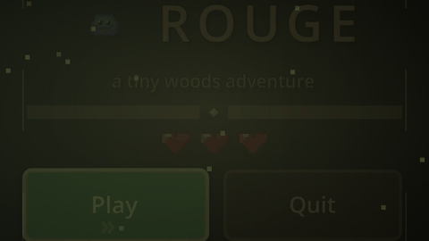
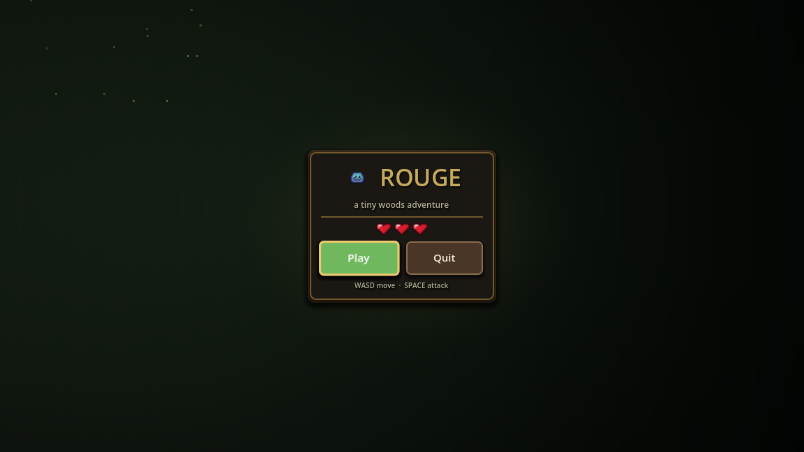
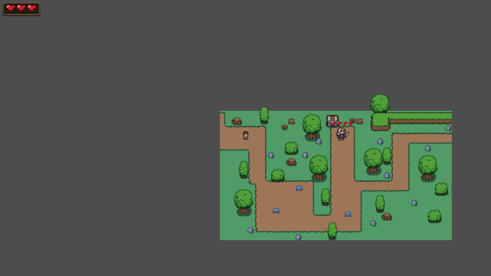
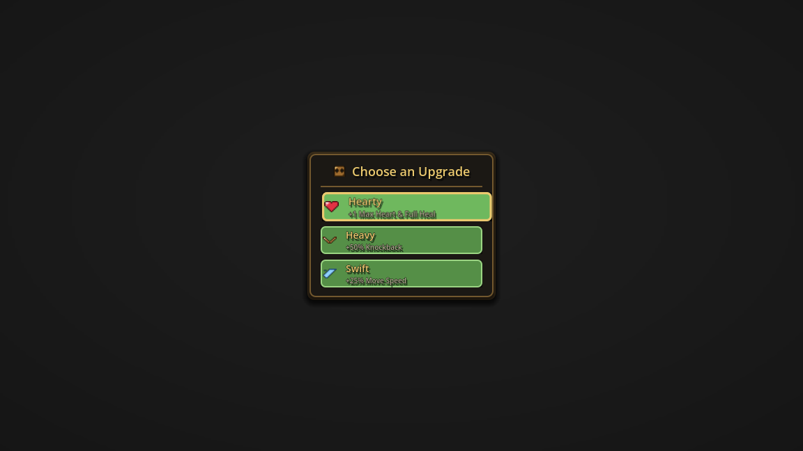
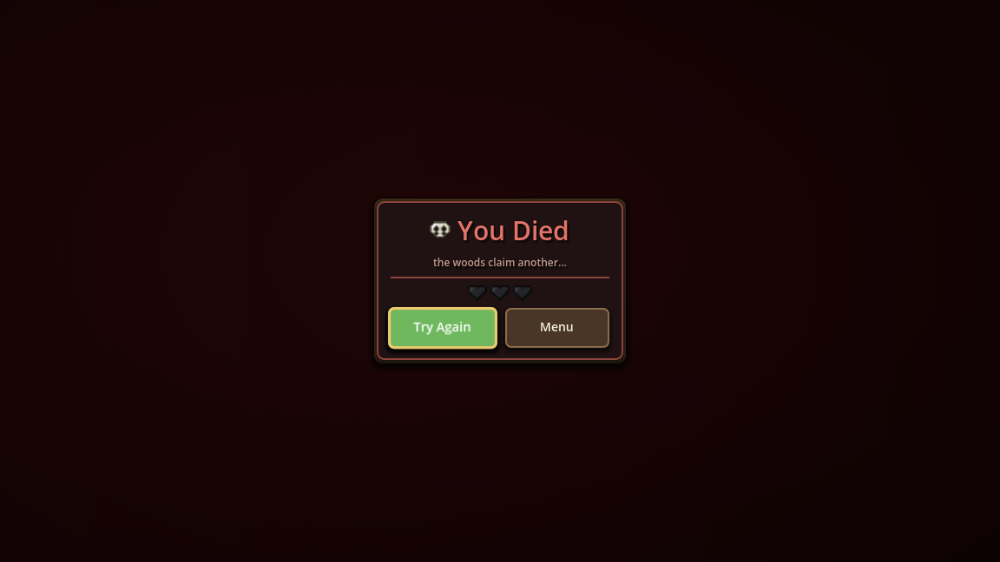

# Rouge

A tiny 2D woods roguelike built with **Godot 4.7**.

Slash slimes and a skeleton miniboss, open the chest to pick from a set of
roguelike upgrades, and see how long you can survive the woods.

## Screenshots & Animations

| Menu — bobbing title, fireflies, drifting mist | Upgrade cards — staggered entrance, hover slide + sweep |
|:---:|:---:|
|  |  |

| Combat — damage numbers, boss bar, HUD stats | Game over — crimson wash, elastic pop |
|:---:|:---:|
|  |  |

<details>
<summary>Static screenshots</summary>

| Title screen | Gameplay |
|:---:|:---:|
|  |  |

| Upgrade choice | Game over |
|:---:|:---:|
|  |  |

</details>

## Controls

| Input | Action |
|-------|--------|
| WASD / Arrow keys | Move |
| SPACE / Enter | Attack · interact (open the chest) |

## Features

- Zelda-style heart HUD, and a miniboss that shows its own hearts
- Chest shrine with 6 upgrades: Hearty, Swift, Sharp, Quick, Heavy, Sturdy
- Y-sorted trees, cliffs you can hop down, knockback combat with i-frames
- Retro-arcade UI juice: breathing menu with drifting fireflies, squash-and-stretch
  buttons, staggered upgrade cards with hover glow + highlight sweep, hearts that
  shake and flash on damage (pulse on heal), and an elastic "You Died" cinematic
- Portfolio-grade UI systems: floating combat numbers, boss nameplate with
  segmented health bar, run timer + kill tracker, pause menu with volume sliders
  and fullscreen toggle, upgrade toasts, and a pixel-dissolve scene transition
  shader (`scripts/dissolve.gdshader`)
- Pixel-art UI built entirely in code (`scripts/ui_theme.gd`)

## Running

Open the project in **Godot 4.7+** and press F5, or from a terminal:

```sh
godot --path .
```

## Project layout

- `scenes/` — menu, world, player, enemies, bones miniboss
- `scripts/` — gameplay and all UI code
- `art/` — sprite assets

## Credits

- **Mystic Woods (free)** art pack by [Game Endeavor](https://game-endeavor.itch.io/mystic-woods) — non-commercial license
- **Enemy Animations Set** skeleton sprites
- Made with the [Godot Engine](https://godotengine.org/) (MIT)
